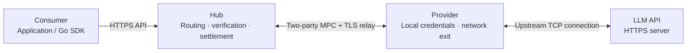

# TokenHive Half-MPC TLS

**An LLM gateway that routes requests through providers' own API credentials and network connections, while the Hub verifies upstream responses and accounts for usage.**

TokenHive is built for services that coordinate multiple LLM API providers. Consumers call a central Hub using their TokenHive account. Providers contribute access to an upstream model service through credentials kept on their own machines. The Hub handles routing, streaming and settlement without collecting those upstream API keys in plaintext.

The core mechanism is **selective two-party computation (MPC) for TLS**. Hub and Provider jointly perform the TLS operations needed to authenticate a request containing the Provider's credential. Hub authenticates the upstream server and decrypts its response, so usage accounting can be based on the upstream response it verifies.

Credential privacy assumes a **trusted, protocol-following Hub**. Providers may be malicious. The current implementation and its limits are described below.

## How it works



| Role | Responsibility |
| --- | --- |
| **Consumer** | Submits model requests, receives JSON or SSE, and queries task and billing status using its own Hub account. |
| **Hub** | Selects a Provider, reserves a usage budget, participates in MPC, verifies the upstream TLS response and records settlement. Runs Go services and a Hub-role Rust sidecar. |
| **Provider** | Holds the upstream API credential locally, contributes it as an MPC private input and supplies the upstream network connection. Runs a Go Agent and a Provider-role Rust sidecar. |

For each request, Hub selects a prewarmed, single-use session. Both parties check the canonical request and its binding before the Provider contributes its credential. The request is delivered through the Provider's upstream connection; Hub authenticates the response and extracts usage. Successful JSON responses and SSE completion wait for durable settlement.

### Why “Half-MPC”?

Selected TLS operations involving secret credentials and shared key material run jointly. Other work runs locally when the key ownership rules allow it, reducing the amount of computation inside MPC.

In the TLS 1.3 engine, the credential prefix and a KeyUpdate message are encrypted through MPC. After delivery is confirmed, Hub receives the next-generation client key and encrypts the remaining request locally. Hub also authenticates and decrypts server responses locally. Each session is consumed by one request.

See [the current architecture](docs/current-architecture.md) and [TLS 1.3 engine](rust/crates/tls13/README.md) for the exact key-release and authentication boundaries.

## What is included

- **LLM request API:** `/v1/chat/completions` with JSON and SSE, a concurrent Go SDK, and an embeddable Go Hub package.
- **Provider integration:** authenticated Hub–Agent control/data channels, local credential resolution and Provider-side upstream connections.
- **Session management:** prewarming, routing, bounded FIFO queues, backpressure, timeouts and single-use session cleanup.
- **Usage accounting:** budget reservations, durable receipts, account-scoped idempotency and task queries, and crash recovery.
- **Validation tools:** real two-party MPC tests, four-process demos, fault injection, continuous-load tests and profiling.

The cryptographic implementation uses Rust with TLSNotary/MPZ components; admission, orchestration, streaming and accounting are implemented in Go.

## Try it locally

Requires Linux or macOS, Go 1.24+, the Rust toolchain pinned in [rust-toolchain.toml](rust-toolchain.toml), Python 3 and OpenSSL. The first build downloads locked dependencies.

```sh
make smoke              # Build and verify the full TLS 1.2 flow
make smoke-tls13        # TLS 1.3 with one shared 5 MiB capacity profile
make smoke-tls13-large  # TLS 1.3 with a near-limit request
```

These commands generate temporary test credentials and certificates, launch Hub, Provider Agent, both Rust sidecars and a local HTTPS fixture, then check JSON/SSE, the Go SDK, request binding, idempotency and settlement. They use real MPC with synthetic model responses and make no paid API calls. Artifact locations are printed at the end.

To keep a demo running and call it from another terminal:

```sh
make demo
# Use the client configuration path printed by the demo:
go run ./examples/go/chat /tmp/tokenhive-demo-.../client.json
```

For a persistent TLS 1.3 demo, run `python3 scripts/demo.py --tls-version 1.3` after building.

## Integrate or deploy

Use [client](client/) to call Hub from Go, or [hub](hub/) to embed the Hub service in an existing Go process. Rust sidecars and Provider Agent remain separate processes. Start with the [integration guide](docs/business-integration-zh.md) and [compilable examples](examples/go/).

Deployment requires your own certificates, Provider credentials, Consumer accounts and balances, model policy and pricing. Example configurations are available for [Hub](config/hub.example.json), [TLS 1.3 Hub](config/hub-tls13.example.json) and [Provider Agent](config/provider.example.json).

| Engine | Default capacity | Request encryption |
| --- | --- | --- |
| TLS 1.2 — compatibility default | 4 KiB `baseline`; six explicit profiles | MPC preprocessing grows with the configured request budget. |
| TLS 1.3 — explicitly enabled | One shared 5 MiB `5m` profile | Fixed credential prefix of at most 1 KiB in MPC; remaining request encrypted locally after KeyUpdate. |

Both roles and the Hub route must agree on TLS version and exact capacity. There is no automatic downgrade. TLS 1.3 currently supports P-256, `TLS_AES_128_GCM_SHA256` and HTTP/1.1. See [deployment compatibility](docs/adr/0004-upstream-compatibility-validation.md) and [upgrade requirements](docs/adr/0007-session-local-hmac-prefix-states.md).

## Trust model and current status

Hub is trusted to follow the protocol, verify upstream identity and responses, and settle correctly. Consumers trust Hub; receipts are Hub accounting records. The upstream API and its certificate trust chain are trusted. Provider credentials remain local and enter MPC as private inputs. Protection against an actively malicious or compromised Hub is outside the current model.

Provider-side deviations are checked through request binding, certificate and Finished verification, authenticated MPC outputs, record authentication and state-machine constraints. These checks remain necessary under the trusted-Hub model.

The implementation has passed local functional, race, real-MPC and fault-recovery tests. A 15-minute TLS 1.3 run completed 2,928 requests with no failures or unsettled tasks. On an Apple M3 Pro, the five-minute saturated JSON phase sustained about **7.76 requests/s**, with **585 ms P95** full-response latency, including a fixed 200 ms synthetic upstream delay. See [the measurements and scope](docs/performance/production-validation-2026-10-27.md).

Production admission remains pending: real Provider exits and authenticated model calls, longer cross-host operation and independent cryptographic review still need validation. The current ledger supports one Hub writer. Over-budget authenticated usage is retained in `review_required` with its reserve held; reconciliation policy and adjustment tooling remain to be implemented. See [the design review](docs/design-review-2026-10-27.md) for outstanding boundaries.

## Development and validation

```sh
make build              # Go binaries and release Rust sidecar
make test               # Go race tests and Rust workspace tests
make check              # Go vet, Rust formatting and Clippy
python3 -m unittest discover -s scripts -p test_diagnostics.py

# Verify the same release sidecar artifact used by the deployment:
TMPDIR=/tmp TOKENHIVE_TEST_SIDECAR_BINARY="$PWD/rust/target/release/tokenhive-sidecar" \
  go test -tags=integration ./internal/sidecar

# Real two-party TLS 1.3 tests are ignored by the ordinary workspace run:
cargo test --manifest-path rust/Cargo.toml --locked --release -p tokenhive-tls13 \
  --test real -- --ignored --nocapture --test-threads=1

make bench-e2e-quick     # Short end-to-end benchmark
make validate-local     # Fault recovery, CPU profile and 3 × 5-minute load
make profile-warm       # Stage timings and native stack sampling
```

Stage profiling is opt-in with `TOKENHIVE_PROFILE_STAGES=1`. Nested intervals and whole-process CPU measurements require care; see [the profiling guide](docs/warm-profiling.md).

## Documentation

| Topic | Reference |
| --- | --- |
| Architecture, keys and lifecycle | [Current architecture](docs/current-architecture.md) · [Architecture decisions](docs/adr/README.md) |
| SDK, configuration and accounting behavior | [Business integration](docs/business-integration-zh.md) · [Go examples](examples/go/) |
| Component protocols | [Sidecar RPC](docs/sidecar-rpc-v1.md) · [Agent control](docs/agent-control-v1.md) |
| Performance and validation | [Optimization report](docs/performance/optimization-2026-10-27.md) · [Continuous load and recovery](docs/performance/production-validation-2026-10-27.md) · [Performance design](docs/performance-design-zh.md) |
| Design assessment and history | [Design review](docs/design-review-2026-10-27.md) · [Implementation history](docs/implementation-history.md) |

The original [Chinese](docs/half-mpc-tls-binding-zh.md) and [English](docs/half-mpc-tls-binding-en.md) protocol papers are historical design proposals. Current behavior, trust boundaries and measured performance are documented in the references above.
