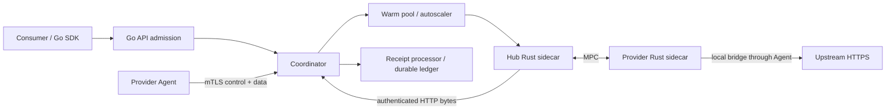

# 当前架构与接口约束

更新：2026-10-27。本文描述当前实现；原始中英文协议论文及里程碑历史不作为部署契约。

## 安全与密钥归属

Hub 由平台控制，被信任遵守协议、验证真实上游响应并执行正确结算。Provider 可以恶意，上游 API 与证书信任链可信；Consumer 信任 Hub，不独立验证 TLS 证据。Provider 的凭证明文由本地 resolver 读取并作为 MPC 私有输入，Hub 不正常接收凭证明文。当前不抵抗主动恶意或被攻陷的 Hub。

| 数据 | Hub | Provider |
| --- | --- | --- |
| 规范请求、模型、请求哈希 | 持有并验证 | 独立验证 |
| Provider 凭证明文 | 不接收 | 本地持有，填入固定槽位 |
| 服务端响应解密材料 | 握手认证后持有 | 不输出给 Provider |
| TLS 1.2 客户端密钥 | 保留在两方计算中 | 保留在两方计算中 |
| TLS 1.3 旧客户端 secret、凭证位置密钥流 | 不输出明文 | 不输出明文 |
| TLS 1.3 旧记录 H、tag mask | 持有，依赖可信 Hub 计算 tag | 不持有完整材料 |
| TLS 1.3 下一代客户端 secret | 前缀和 KeyUpdate 投递后持有 | 不输出给 Provider |

实现约束和安全模型是两回事：可信 Hub 仍必须通过状态机防止 nonce 重用、并发误用和一次性材料重复消费。输出认证、证书、DNS、Finished、请求绑定与容量校验不能因为信任 Hub 而删除。

## 模块与接口

- `client` 只处理 Consumer HTTP/JSON/SSE 和任务查询，不接触 MPC 或 Provider 凭证。
- `hub.Run` 是进程装配接口；`internal/api` 负责账号鉴权、限流、有界读请求、任务键与 HTTP 错误。
- `Coordinator.Execute` 连接路由、预留、独占 lease、双端绑定校验、响应认证和回执。任务一旦预留即绑定幂等键，不自动重派。
- `precompute.Pool` 管理活跃且已完成握手的 Resource；Warmer 承担全部准备和失败清理。FIFO 按单 key 等待顺序，不保证跨池公平或完成顺序。
- `SidecarSession.EncryptAndDeliver` 是完整请求发送接口，封装双方 RPC、凭证贡献和 Provider 上游交付屏障。业务调用方不管理记录序号或秘密偏移。
- Rust sidecar 管理连接所属会话、附件、严格状态转换和角色固定的 TLS 引擎；错误或取消使会话不可复用。
- `ReceiptSink` 只在认证完整响应后接收证据；Processor 先落盘证据，再应用账本。日志适配器是单写者，当前不支持多个 Hub 共写账本。

## 一次请求的生命周期

1. Consumer 身份认证，规范化 JSON；SSE 强制请求 usage，拒绝重复 JSON key 与不一致字段。
2. 根据模型、健康状态、ready 库存、观测响应头延迟、容量和负载选 route。请求哈希覆盖含零凭证槽的完整规范 HTTP。
3. 以 task ID 和价格快照预留最大账务预算，再排队取得 lease。排队满或超时发生在上游发送之前，并取消预留。
4. 两方独立验证规范请求、模型、streaming 与哈希，Provider 只贡献本地凭证。请求完成等待累计字节数与 SHA-256 前缀绑定的 socket 写入 ACK；ACK 不表示上游应用已处理请求。
5. Hub 认证并解析响应。JSON 完整缓存并校验后返回；SSE 逐事件校验转发，DONE 延迟到最终 usage、认证 EOF 和持久结算成功。
6. 成功结束、错误、取消或期限到达时销毁 lease。一次性 MPC 材料不返回可复用库存；后台补库存受单 key 与全局预热并发限制。

Consumer 响应期间断开，不会立即取消上游认证与结算；继续排空至原请求期限。期限驱动传输关闭与错误归因使用同一 context，避免本地超时误罚 Provider。进程停止、网络故障与本地超时不构成上游未处理请求的证明。

## 库存与传输预算

Pool key 包括 Provider、credential 引用、host/port/SNI、TLS 版本和精确容量；这些 key 不能混用。TLS 1.2 默认 baseline，按请求预算选择六档独立预处理。TLS 1.3 新部署使用单个 `5m` 档位；小请求与大请求共享一池，固定凭证电路不会因此扩大。

每个会话独占一个 Provider mTLS 数据连接 generation，RPC/MPC/桥接句柄都绑定其生命周期。默认 32 槽是 warming、READY 和 leased 的合计预算，而不是单独的在线并发数；跨 credential/容量共享该预算。后台计算并发与连接槽位是不同限制，增加库存不能替代持续预热吞吐。

当前只提供 READY 库存；PREPARED 两层池、TLS 1.2 多请求复用和 QUIC 的评估结论见 ADR，不通过删除一次性检查或扩大 MaxUses 来启用。

## 持久化与异常状态

| 任务状态 | 资金与证据 | 重启行为 |
| --- | --- | --- |
| `pending` | 已预留，尚无最终账务结果 | 先回放完整回执，再取消无回执中断任务 |
| `settled` | 已计费/分账或非计费结果退款 | 幂等恢复，不重派 |
| `cancelled` | 已退款，原键仍绑定 | 不重复退款、不自动重派 |
| `review_required` | 超预算认证回执与原预留保留，不扣款、退款或分账 | 确认持久状态后继续其他回执；不当作无证据任务退款 |

待核对状态公开 `review_reason` 和认证用量，但不暴露 Provider 身份、分账比例或秘密。目前没有自动/人工调账接口，账务解决政策属于后续工作；不能把这一状态当作成功结算。

账户与回执文件是权限受限、hash-chain、fsync 的单写者日志。它们提供崩溃恢复和内部一致性检查，不是第三方可独立验证的密码学收据，也不能抵抗控制 Hub 文件系统的攻击者重写整条链。多 Hub 部署需要事务存储与明确任务归属。

## 兼容与验证范围

四个可执行文件不按构建版本号强制一致；兼容性取决于 v1 framing、严格 JSON、角色、必需特性、MPC 时序与精确容量。未知可选 feature 可共存；缺少必需能力、模式或容量不匹配即拒绝，不降级为普通 TLS。当前没有真实 v2 协议可供区间选择。

测试分为 Go/race、Rust workspace、显式 ignored 的真实双方 MPC、真实四进程 JSON/SSE/账务，以及部署网络和真实上游准入。后两者不能由纯电路或单机微基准代替。最新实测和未验证部分分别记录在 [设计评审](design-review-2026-10-27.md)、[profiling](warm-profiling.md) 和 [ADR](adr/README.md)。
